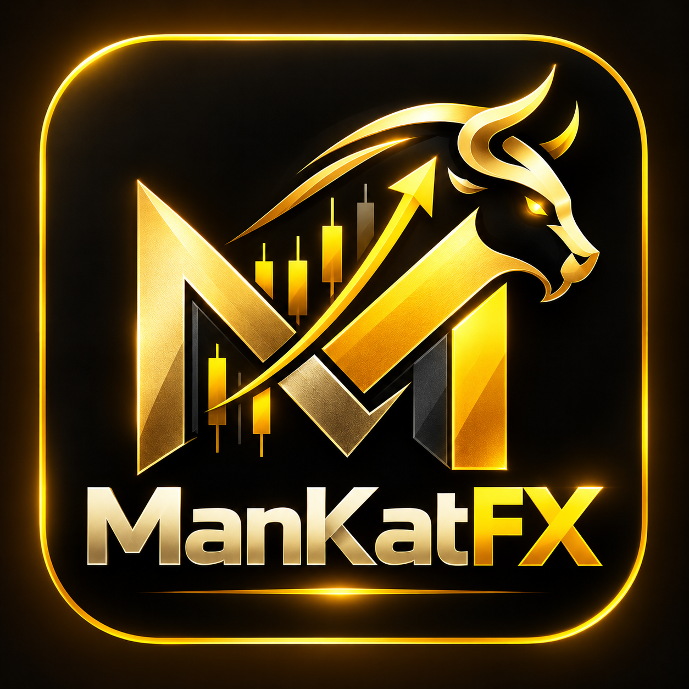

 

  

  # ManKatFX Trading Journal

  **Trade with precision. Review with purpose. Grow with discipline.**

  A modern, all-in-one trading journal designed to help traders track performance, manage risk, analyze strategies, and build consistent trading habits.

  ---

## About

ManKatFX is a trading performance workspace built for traders who want more than just a record of their trades. It brings journaling, analytics, risk management, strategy tracking, and performance review into one streamlined interface.

## Features

- **Trading Dashboard** — Monitor key performance metrics and your trading progress.
- **Trade Journal** — Log, organize, and review individual trades.
- **Performance Analytics** — Understand win rates, profit and loss, drawdown, and trading patterns.
- **Risk Management** — Use trading calculators to support position sizing and risk decisions.
- **Trading Calendar** — Review trading activity and performance across dates.
- **Strategy Tracking** — Document strategies and evaluate their performance.
- **Backtesting** — Record and review historical strategy tests.
- **Goals & Reports** — Track trading objectives and gain insights into your progress.
- **Market Watch** — Keep relevant market information within reach.
- **Responsive Design** — A sleek, dark interface with gold accents, built for a focused trading workflow.

---

  **ManKatFX — Plan your trades. Track your edge. Master your process.**

